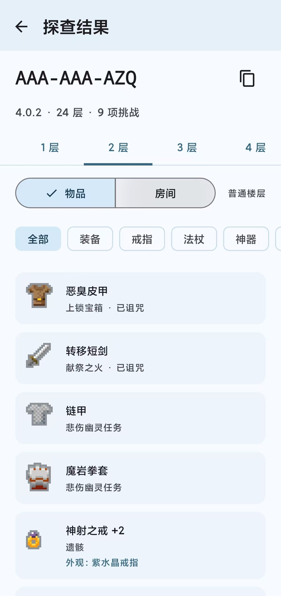
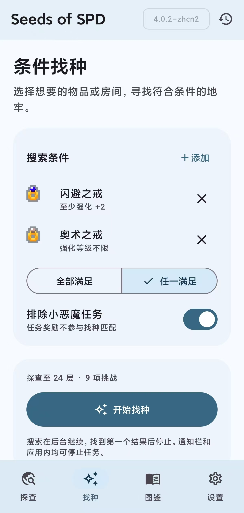
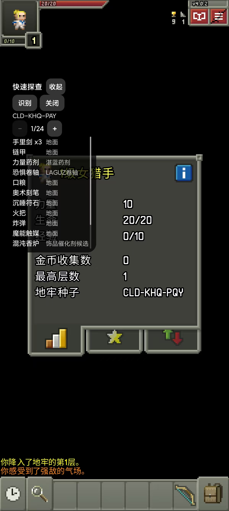

# Seeds of SPD

SoSPD是一款用于[Shattered Pixel Dungeon](https://github.com/00-evan/shattered-pixel-dungeon)的中文查种器，仅提供Android版本，基于Material3开发。部分代码参考来自[shpd-toolkit](https://github.com/Elektrochecker/shpd-toolkit)。

项目面向中文玩家群体，仅支持**简体中文**。

*兼容测试范围Android 10+，过旧的硬件或者软件可能不能正常运行。*

<table>
  <tr>
    <th>种子探查</th>
    <th>条件找种</th>
    <th>快速探查</th>
  </tr>
  <tr>
    <td></td>
    <td></td>
    <td></td>
  </tr>
</table>

